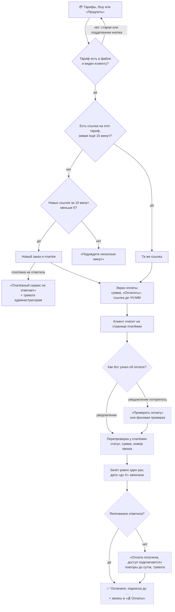
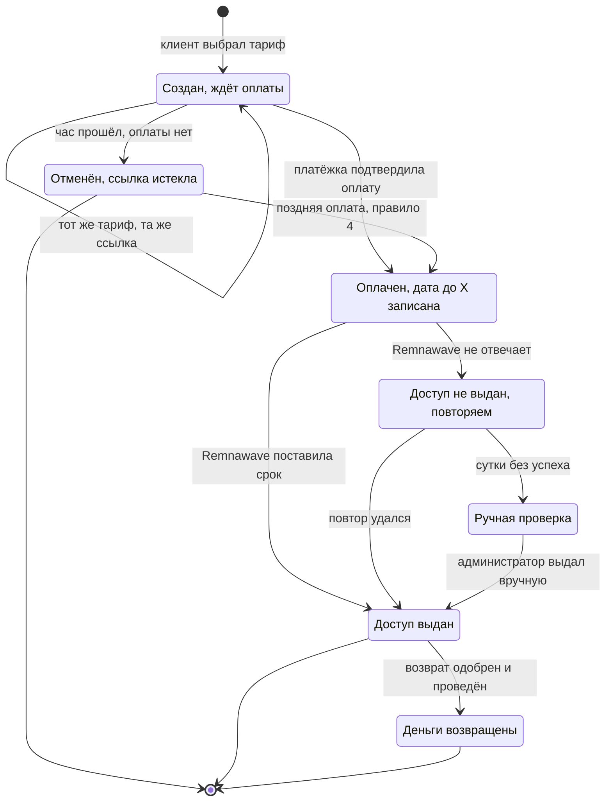
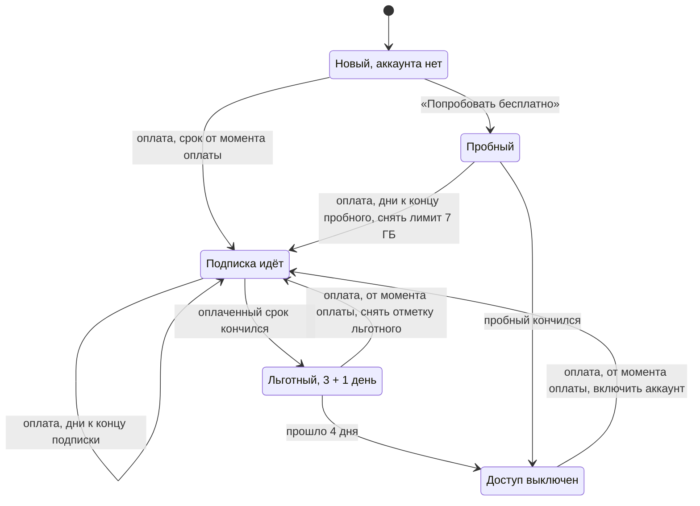
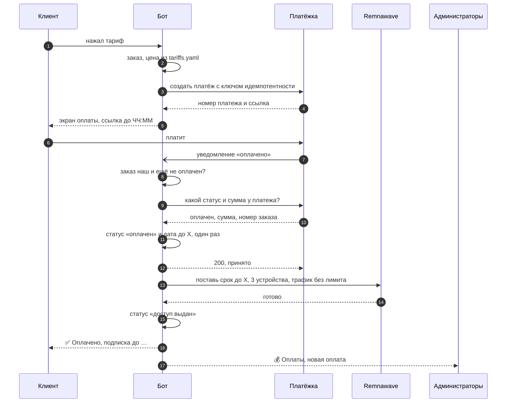
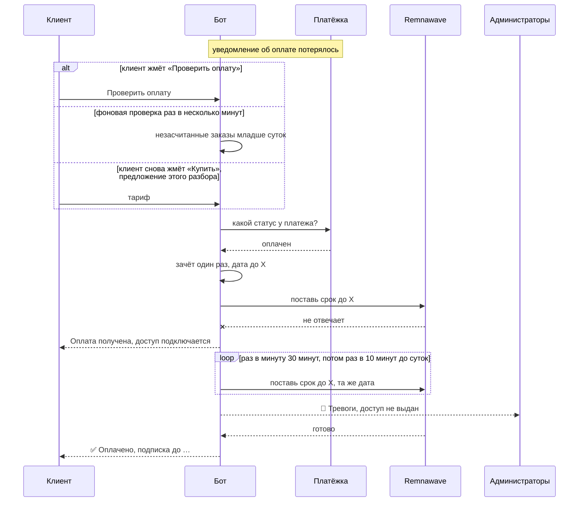
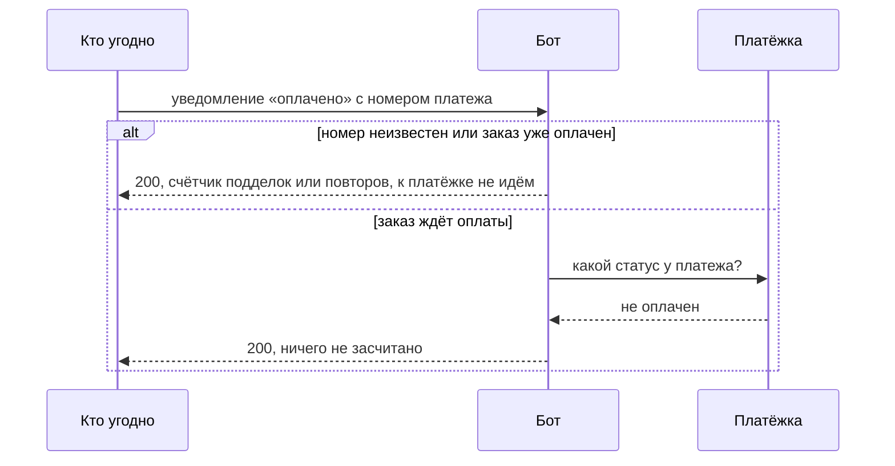

# Карта пути клиента по оплате и уязвимые места

Задача 30, 2026-10-25. Код не менялся — это разбор.

**Что сделано на сегодня, а что в плане.** Сделана только задача 12: тарифы, заказ, ссылка на оплату на поддельной платёжке (`services/orders.py`, `bot/tariffs.py`, `integrations/fake_payments.py`) и правила сроков в `domain/` (откуда считать срок, пересчёт при другой сумме, льготный период, возврат). **Зачёт оплаты и выдача доступа (задача 13) сейчас пишутся** в другой ветке, уведомления, «Проверить оплату» и фоновая проверка (14), настоящая платёжка (15), возвраты (21), режим «оплата выключена» (29) — ещё не начаты. Для них разбор идёт по тексту задач и спецификации и помечен «план: задача N».

## Слова, которые встретятся

- **Платёжка** — платёжный сервис (ЮKassa или Robokassa, ещё не выбран), на странице которого клиент вводит карту или платит по СБП.
- **Заказ** — запись в нашей базе «клиент хочет тариф X за Y ₽». **Платёж** — то же самое на стороне платёжки, со своей ссылкой и номером.
- **Уведомление** (вебхук) — сообщение, которое платёжка сама присылает боту на его адрес: «платёж такой-то оплачен». Может потеряться, прийти дважды или оказаться подделкой.
- **Перепроверка** — бот не верит уведомлению на слово, а сам спрашивает у платёжки статус платежа по её API (программному входу).
- **Зачёт** — бот признаёт заказ оплаченным: ставит статус «оплачено» и считает, до какой даты продлить подписку.
- **Выдача** — бот просит Remnawave (панель, где живут прокси-аккаунты клиентов) поставить новый срок.
- **«До X»** (`grant_target_expire_at`) — конкретная дата окончания, которую бот считает один раз и хранит в заказе. В Remnawave передаём «поставь срок до X», а не «прибавь 30 дней», поэтому повтор не прибавит дни второй раз.
- **Атомарно** — изменение, которое либо прошло целиком, либо не прошло вовсе, и которое два одновременных запроса не могут сделать оба.
- **Гонка** — два действия случились почти одновременно, и результат зависит от того, кто успел первым.
- **Блокировка на клиента** — правило внутри бота: пока идёт одно действие с подпиской клиента, второе ждёт своей очереди.
- **Ключ идемпотентности** — метка запроса к платёжке: повтор с той же меткой не создаёт второй платёж, а возвращает первый.
- **Фоновая проверка** — задача, которая сама, без клиента, раз в несколько минут спрашивает у платёжки статус незасчитанных заказов.
- **Сверка** — сравнение нашей базы с данными платёжки или Remnawave, чтобы найти расхождения.
- **Тишина** — сбой, о котором никто не узнаёт: ни клиент, ни администраторы.

## 1. Как работает оплата — коротко

1. Клиент жмёт «💳 Тарифы» (или `/buy`, или «💳 Продлить подписку» в профиле) и выбирает срок.
2. Бот создаёт **заказ** с ценой из файла `tariffs.yaml` (кнопка несёт только название тарифа, цену из неё бот не берёт) и просит платёжку создать **платёж**. Клиент получает экран: сумма, кнопка «Оплатить», «ссылка действует до 14:05».
3. Ссылка живёт час. Повторное нажатие того же тарифа даёт ту же ссылку, если ей осталось не меньше 15 минут. Другой тариф — новый заказ и новая ссылка. Больше 5 новых ссылок за 10 минут не даём.
4. Клиент платит на странице платёжки. Платёжка присылает **уведомление**. Бот проверяет, что заказ наш и ещё не оплачен, **перепроверяет** у платёжки статус и сумму и **засчитывает** заказ ровно один раз. *(план: 13, 14)*
5. Бот считает дату **«до X»**: подписка идёт или пробный — дни добавляются к окончанию; льготный период, истёкшая подписка или новый клиент — от момента оплаты. Затем просит Remnawave поставить срок до X, снять лимит трафика пробного и поставить 3 устройства. *(план: 13)*
6. Клиент получает «✅ Оплачено, подписка до 10.12.2026, 18:00 МСК», администраторы — запись в теме «💰 Оплаты». *(план: 13)*
7. Если уведомление потерялось — кнопка «Проверить оплату» и фоновая проверка. Если Remnawave не отвечает — «Оплата получена, доступ подключается», повторы минуту за минутой до суток и тревога. *(план: 13, 14)*
8. Дальше — напоминания, льготный период 3 + 1 день, возврат за неиспользованные дни по решению администратора. *(льготный — правила в `domain/grace.py`; возврат — план: 21)*

## 2. Схемы

Пунктиром обведены шаги, которых в коде ещё нет (задачи 13–15).

### 2а. Путь клиента: от «💳 Тарифы» до «✅ Оплачено»

### 2б. Статусы заказа

Все статусы уже есть в базе (`db/enums.py`, `OrderStatus`), но сейчас код ставит только «создан». Переходы — по задачам 04, 13, 14, 21.

Важно: переход «Отменён → Оплачен» обязателен. По правилу 4 задачи 04 любая подтверждённая оплата засчитывается, даже по старой ссылке. Если бот будет отбрасывать уведомления по отменённым заказам, деньги клиента пропадут (уязвимость 2 ниже).

### 2в. Состояние клиента и откуда считается новый срок

Правила — `domain/subscription.py` (`grant_target_expire_at`), покрыты тестами `tests/domain/test_subscription.py`.

### 2г. Бот, платёжка и Remnawave: основной путь

Шаги 7–17 — план задач 13 и 14. Ответ «200» платёжке уходит только после записи в базу: если база упала, платёжка повторит уведомление позже.

### 2д. Страховки: уведомление потерялось, Remnawave лежит

### 2е. Поддельное или повторное уведомление

Всё на 2е — план задачи 14. Подделки склеиваются в одну запись журнала и одну тревогу (решение по аудиту, п. 13).

## 3. Таблица сценариев

Риск: **нет** / **низкий** / **средний** / **высокий**. «Покрыто сейчас» — где это уже сделано (код или тест) или в какой задаче запланировано. «Уяз. N» — ссылка на раздел 4.

### А. Выбор тарифа и ссылка на оплату

| № | Ситуация | Что видит клиент | Что делает бот | Деньги | Доступ | Риск | Покрыто сейчас? |
|---|---|---|---|---|---|---|---|
| А1 | Двойное нажатие тарифа, в том числе одновременное | Одну и ту же ссылку | Блокировка на клиента, тот же заказ | Не списаны | Без изменений | нет | код `orders.checkout`; тесты `test_double_press_gives_one_payment`, `test_simultaneous_double_press_gives_one_payment` |
| А2 | Тот же тариф позже, ссылке жить ≥ 15 минут | Ту же ссылку | Переиспользует платёж | — | — | нет | код `domain/payments.can_reuse_payment`; тест `test_fresh_link_is_reused` |
| А3 | Тот же тариф, ссылке осталось < 15 минут | Новую ссылку | Новый заказ и платёж; старая ссылка ещё жива до 15 минут | Можно оплатить обе | Обе оплаты сложатся | низкий | код + тест `test_link_about_to_expire_is_replaced`; поиск двойных оплат — нет (уяз. 1) |
| А4 | Два разных тарифа подряд, обе страницы оплаты открыты | Две ссылки | Два заказа | Можно оплатить оба | Сложатся оба срока | средний | код + тест `test_other_tariff_gives_new_payment`; поиск двойных оплат — нет (уяз. 1) |
| А5 | Старая кнопка тарифа, которого уже нет в файле | «Этого тарифа больше нет», список тарифов | Отказ, новый заказ не создаётся | — | — | нет | код `bot/tariffs.on_tariff`; тест `test_unknown_tariff_is_refused` |
| А6 | Подделанная кнопка скрытого тарифа за 15 ₽ | То же, что А5 | Отказ: скрытый тариф только `ADMIN_IDS` | — | — | нет | тесты `test_forged_hidden_tariff_button_is_refused`, `test_hidden_tariff_is_refused_for_client` |
| А7 | Цена в файле изменилась, пока ссылка жива | Новую ссылку с новой ценой | Новый заказ; старый по старой цене ещё можно оплатить | По старой ссылке — старая цена | Дни старого заказа | нет | тест `test_changed_price_is_not_reused` |
| А8 | Больше 5 новых ссылок за 10 минут | «Подождите несколько минут» | Не идёт к платёжке | — | — | нет | тест `test_too_many_new_payments` (число 5 ждёт подтверждения, ideas №17) |
| А9 | Платёжка не ответила при создании | «Платёжный сервис не отвечает» | Тревога; заказ без платежа; повтор — с тем же ключом | Не списаны | — | низкий | тесты `test_payments_down_apologizes_and_alerts`, `test_provider_down_then_retry_uses_same_order_and_key` |
| А10 | Платёжка создала платёж, но ответ потерялся | «Сервис не отвечает» | Повтор с тем же ключом возвращает тот же платёж; через час — новый заказ | Брошенный платёж никто не видел, оплатить нельзя | — | нет | код `_retry_allowed` |
| А11 | Старое сообщение, ссылка истекла, клиент жмёт «Оплатить» | ЮKassa: «платёж отменён». Robokassa: зависит от срока счёта — может дать оплатить | — | Robokassa: может пройти оплата старого заказа | Должен быть выдан (Б5) | средний | план: 15 (срок счёта у Robokassa — уяз. 9) |
| А12 | «Оплатить» по ссылке уже оплаченного заказа | ЮKassa: «уже оплачено» | — | Второй раз не списать (ЮKassa) | — | низкий | ЮKassa — по документации; Robokassa — уточнить в 15 (уяз. 9) |
| А13 | Ссылку переслали другу, друг оплатил | — | Засчитает тому, чей заказ | Оплатил друг | Получает владелец заказа | нет | так задумано |
| А14 | Запись платежа в базу упала после создания платежа | Ошибку, ссылки нет | Ошибка не глотается | Ссылку никто не видел | — | нет | код `_attach_payment` |
| А15 | Клиент вернулся со страницы оплаты, «✅» ещё нет (уведомление в пути) | Экран оплаты | — | Списаны | Через секунды | низкий | Если снова жмёт тот же тариф — та же ссылка (А2). Если ссылке < 15 минут — новая, риск двойной оплаты (уяз. 1) |
| А16 | Режим «оплата выключена» | «Оплата скоро появится» | Заказы не создаёт | — | — | нет | план: 29 |

### Б. Оплата и уведомления

| № | Ситуация | Что видит клиент | Что делает бот | Деньги | Доступ | Риск | Покрыто сейчас? |
|---|---|---|---|---|---|---|---|
| Б1 | Обычная оплата | «✅ Оплачено, подписка до …» | Перепроверка, зачёт, выдача, «💰 Оплаты» | Списаны один раз | Выдан | нет | план: 13, 14 |
| Б2 | Уведомление пришло дважды | Одно сообщение | Заказ уже оплачен — 200, ничего | — | Без изменений | нет | план: 13 (атомарный зачёт), 14 |
| Б3 | Уведомление потерялось | Сначала ничего, потом «✅» после проверки | «Проверить оплату» или фоновая проверка | Списаны | С задержкой | средний | план: 14. **Сейчас защиты нет вообще** |
| Б4 | Уведомление потерялось, через час клиент жмёт «Купить» | Новую ссылку | Создаёт новый платёж, о старой оплате не знает | **Вторая оплата** | Удвоится, если засчитают обе | **высокий** | нет; ideas №12 → уяз. 1 |
| Б5 | Оплата пришла после закрытия заказа как истёкшего (поздний СБП, Robokassa без срока, уведомление через сутки) | Ничего | Если отбрасывает уведомления по отменённым заказам — молчит | **Списаны, услуги нет** | Нет | **высокий** | нет; уяз. 2 |
| Б6 | Поддельное уведомление с выдуманным номером | — | 200 без запроса к платёжке, склейка, одна тревога | — | — | низкий | план: 14 |
| Б7 | Поддельное «оплачено» с настоящим номером неоплаченного заказа | — | Перепроверка видит «не оплачен» — ничего | — | — | нет | план: 14 (аудит §4.1) |
| Б8 | Поддельная «отмена» для заказа | — | Отмену тоже перепроверяет | — | — | низкий | план: 14 (аудит §4.1) |
| Б9 | Уведомление пришло раньше, чем бот записал номер платежа (доли секунды) | «✅» с задержкой | Номер неизвестен — отброшено; подхватит фоновая проверка | Списаны | С задержкой | низкий | план: 14 — только если фоновая проверка есть |
| Б10 | Уведомление, кнопка и фоновая проверка одновременно | Одно «✅» | Атомарный переход «создан → оплачен», выигрывает один | Один раз | Один раз | нет | план: 13 |
| Б11 | Оплачено не на сумму тарифа | Извинение и срок «на оплаченную сумму и чуть больше» | Пересчёт: пропорционально + 2 часа, уведомление админам | Как есть | Пропорционально | низкий | правило: `domain/money.paid_duration` + тесты `test_money.py`; применение — план: 13 |
| Б12 | Тестовый платёж в боевом режиме, не рубли, чужой номер заказа в платеже | — | Не засчитывать, тревога | — | — | средний | план: 14, 15 (поля есть в `PaymentState`); уяз. 10 |
| Б13 | Два списания по одной ссылке (если платёжка это позволит) | Одно «✅» | Второй платёж не к чему привязать: номер платежа уникален | **Вторые деньги без услуги** | — | средний | нет; уяз. 6 |
| Б14 | Клиент оплатил два заказа подряд (А3, А4) | Два «✅» | Оба засчитаны, дни сложены | Две оплаты | Сумма сроков | средний | засчитать — план 13; предупредить о двойной оплате — нет (уяз. 1) |
| Б15 | Бот лежал в момент оплаты | «✅» после запуска | Платёжка повторяет уведомление (ЮKassa — 24 часа), фоновая проверка после старта | Списаны | С задержкой | низкий | план: 14 |
| Б16 | База упала посреди зачёта | «✅» позже | Ответ 500 — платёжка повторит; тревога, только если не вышло ни разу | Списаны | С задержкой | низкий | план: 13, 14 (комментарий владельца) |
| Б17 | Remnawave лежит после оплаты | «Оплата получена, доступ подключается» | Повторы минуту × 30, затем раз в 10 минут до суток, тревога | Списаны | С задержкой | средний | план: 13. Что сказать клиенту через час и через сутки — не решено (уяз. 7) |
| Б18 | Бот упал между «оплачено» и «доступ выдан» | «✅» после запуска | Повтор из базы с той же датой «до X» | Списаны | Без лишних дней | низкий | план: 13 (поля `grant_attempts`, `next_grant_attempt_at` в базе уже есть) |
| Б19 | Платёжка не отвечает на «Проверить оплату» | «Не удалось проверить, попробуйте позже» | Повтор фоновой задачей | Списаны | С задержкой | низкий | план: 14 |
| Б20 | «✅ Оплачено» не дошло (сеть, лимит Telegram) | Ничего | Если не повторяет отправку — тишина | Списаны | Есть, но клиент не знает | средний | нет; клиент может заплатить ещё раз (уяз. 7) |
| Б21 | Подделанная кнопка «Проверить оплату» с чужим заказом | Свои заказы | Заказ ищет только у нажавшего | — | — | низкий | план: 14 (аудит R07) |
| Б22 | Клиент жмёт «Проверить оплату» 50 раз | Тот же ответ | Нужен лимит или кэш ответа | — | — | низкий | план: 14 (аудит R29) — в тексте задачи не записано |

### В. Состояние клиента в момент оплаты

| № | Ситуация | Что видит клиент | Что делает бот | Деньги | Доступ | Риск | Покрыто сейчас? |
|---|---|---|---|---|---|---|---|
| В1 | Новый клиент, аккаунта нет | «✅», ссылка подписки | Создаёт `tg_<id>`, срок от момента оплаты | Списаны | Новый аккаунт | нет | правило: тест `test_target_new_client`; выдача — план 13 |
| В2 | Оплата во время пробного | «✅», срок = конец пробного + тариф | Снять лимит 7 ГБ и метку пробного, 3 устройства | Списаны | Без лимита трафика | средний, если лимит забудут снять | правило: тест `test_target_purchase_during_trial_adds_to_trial_rest`; снятие лимита — план 13 (аудит R21) |
| В3 | Пробный «в пути» (панель не ответила при выдаче), а клиент оплатил | «✅» | Доделка пробного видит снятый лимит и ничего не делает | Списаны | Платный | низкий | код `trial._deliver` (проверка лимита) |
| В4 | Оплата при идущей подписке | «✅», дни к концу | — | Списаны | Продлён | нет | тест `test_target_purchase_during_active_subscription` |
| В5 | Срок только что кончился, событие от Remnawave ещё не пришло | «✅», срок от момента оплаты | `max(конец, сейчас)` | Списаны | Продлён | нет | тест `test_start_active_with_stale_expiry_uses_payment_moment` |
| В6 | Оплата в льготный период | «✅», срок от момента оплаты (льготные дни — подарок) | Снять отметку «льготный начался» | Списаны | Продлён | **средний–высокий**, если отметку не снимут | правило: тест `test_target_purchase_during_grace_counts_from_payment`; снятие — план 13, теста нет (уяз. 4) |
| В7 | Оплата после льготного, доступ выключен | «✅» | Срок от оплаты, **включить аккаунт** | Списаны | Должен включиться | средний, если включение забудут | правило: тест `test_target_purchase_after_access_disabled`; включение — план 13 |
| В8 | Оплата в ту же секунду, когда пришло «срок кончился» | «✅» или «льготный начался» | Если нет общей блокировки — льготный может затереть оплаченную дату | Списаны | **Может пропасть** | средний | нет (уяз. 5) |
| В9 | Две оплаты, пока Remnawave лежит | Два «доступ подключается» | Обе даты «до X» посчитаны от одного старого срока | Две оплаты | **Дни первой пропадут** | **высокий** | нет (уяз. 3) |
| В10 | Оплата одновременно с компенсацией за сбой или ручным продлением администратором | «✅» | Тот, кто пишет вторым, затирает даты первого | Списаны | Может пропасть часть дней | средний | нет; план 18, 20 (уяз. 5) |
| В11 | Компенсация в льготный период, потом оплата | «✅», компенсация сохранена | Переносит компенсацию на новый срок | Списаны | + компенсация | нет | тест `test_target_purchase_during_grace_adds_carried_compensation`; применение — план 13, 20 |
| В12 | Аккаунт `tg_` удалили руками в панели | «✅», **новая** ссылка подписки | Пересоздать, тревога | Списаны | Новый аккаунт | низкий | план: 13 (аудит §7.4) |
| В13 | Клиент из нынешних 28 ручных аккаунтов покупает в боте | «✅», новая ссылка | Создаёт отдельный `tg_`, старый не трогает | Списаны | Второй аккаунт; старый живёт своей жизнью | средний (путаница) | так задумано («нынешних не трогаем»); вопрос владельцу 6 |
| В14 | Администратор покупает скрытый тариф за 15 ₽ | «✅», 1 день | Как обычная оплата | 15 ₽ настоящие | 1 день | нет | тест `test_admin_buys_hidden_test_tariff` |
| В15 | Платящий нажимает «Попробовать бесплатно» | Кнопки нет; старая кнопка — «у вас уже есть подписка» | Пробный не выдаёт | — | — | нет | код `trial._has_paid_order` |

### Г. После оплаты: возврат, перенос, спор

| № | Ситуация | Что видит клиент | Что делает бот | Деньги | Доступ | Риск | Покрыто сейчас? |
|---|---|---|---|---|---|---|---|
| Г1 | Клиент просит вернуть деньги | Условия и сумму за полные неиспользованные дни | Заявка в «↩️ Возвраты», решает администратор | Возврат через платёжку | Укорачивается | низкий | расчёт: `domain/refund.py` + `test_refund.py`; процесс — план 21 |
| Г2 | Два администратора одновременно жмут «Одобрить» | Один возврат | Нужен атомарный переход заявки и один ключ идемпотентности | Риск двойного возврата | — | средний | план: 21 — в тексте задачи не записано (уяз. 8) |
| Г3 | Платёжка вернула деньги, а Remnawave не ответила при укорачивании | «Деньги возвращены» | Если не повторяет — срок остаётся длинным | Вернули | **Остался бесплатный доступ** | средний | план: 21 — повторов не записано (уяз. 8) |
| Г4 | Возврат сделан руками в кабинете платёжки, мимо бота | Деньги пришли | Бот не знает | Вернули | Остался | средний (тишина) | нет (уяз. 8) |
| Г5 | Возврат за заказ, после которого куплен ещё один (сроки сложены) | Сумму за этот заказ | Должен отнять только неиспользованные дни этого заказа | — | Не обнулять второй заказ | средний | расчёт по одному заказу есть; укорачивание — план 21, правило не записано (уяз. 8) |
| Г6 | Возврат, потом новая покупка | Обычная покупка | Следующий возврат — не раньше чем через полгода | — | — | нет | тесты `test_refund.py` (правило «раз в полгода») |
| Г7 | Возврат при оплате не на сумму тарифа | Сумма от фактически оплаченного | — | — | — | нет | `refund_amount` от `paid_amount` |
| Г8 | Оспаривание платежа через банк (чарджбэк — банк сам возвращает деньги по жалобе держателя карты) | — | Не знает | Ушли | Остался | низкий | нет; вопрос владельцу 5 |
| Г9 | Перенос подписки на другой Telegram | По подтверждению платежа | Администратор переносит | — | Переносится | низкий | план: 18, 21 (аудит R36) |
| Г10 | Чек при возврате | — | Аннулирует платёжка | — | — | средний (налоги) | план: 15; уточнить у Robokassa (вопрос 7) |

### Д. Клиент и Telegram

| № | Ситуация | Что видит клиент | Что делает бот | Деньги | Доступ | Риск | Покрыто сейчас? |
|---|---|---|---|---|---|---|---|
| Д1 | Клиент заблокировал бота до или после оплаты | Ничего, пока не нажмёт `/start` | Зачёт и выдача проходят; сообщение не дошло — пометка «заблокировал» | Списаны | Выдан | низкий | пометка: код `bot/delivery.py`; зачёт отдельно от отправки — план 13 (уяз. 7) |
| Д2 | Клиент удалил аккаунт Telegram | — | Связаться нельзя | Списаны | Работает по ссылке до конца срока | низкий | перенос только с подтверждением — план 18 |
| Д3 | Новый телефон, тот же Telegram | Всё на месте | — | — | — | нет | клиент по Telegram ID |

### Е. Режимы и обслуживание

| № | Ситуация | Что видит клиент | Что делает бот | Деньги | Доступ | Риск | Покрыто сейчас? |
|---|---|---|---|---|---|---|---|
| Е1 | Поддельная платёжка в боевом режиме | — | Бот не запускается | — | — | нет | тест `test_fake_payments_refuse_prod` (аудит R23) |
| Е2 | Переключили на «оплата выключена», а у клиентов есть свежие заказы | — | Фоновые проверки по задаче 29 не работают | Оплаченные не засчитаны | Нет | средний (тишина) | нет (уяз. 9) |
| Е3 | Перезапуск бота посреди зачёта | — | Повтор из базы | — | — | низкий | план: 13 |
| Е4 | Смена платёжки при открытых заказах | — | Проверять каждый заказ в его платёжке (`payment_provider` в заказе) | — | — | низкий | план: 15 |
| Е5 | Два экземпляра бота с одной базой | — | Блокировка на клиента живёт в памяти одного процесса | — | Возможны гонки В8–В10 | низкий | правило аудита §7.1: один экземпляр |

## 4. Уязвимые места

> **Статус на 2026-10-25, после слияния задач 10, 11, 13 и 18** (дописал ведущий):
> - №3 (две оплаты, пока Remnawave лежит) — **закрыт** задачей 13: заказы клиента выдаются по очереди под блокировкой, срок «до X» считается при выдаче от свежего срока панели.
> - №4 (отметка «льготный» после оплаты) — **закрыт**: зачёт снимает `grace_started_at` в той же транзакции и включает выключенный доступ; ручная выдача (18) — так же.
> - №5 (общая очередь на изменение срока) — **закрыт**: одна блокировка срока клиента `term_locks` у зачёта (13), ручной выдачи (18), а также у льготного (11) и продлений пробного (10) — они решают по аккаунту, перечитанному из панели под блокировкой (`services/term_guard.py`). Компенсация (20) и возвраты (21) должны брать её же.
> - №2 — зачёт уже принимает оплату и для отменённого заказа (13); правило «не отбрасывать отменённые» осталось записать в задачу 14.
> - №7 — «✅ Оплачено» уходит после зачёта; второе сообщение при задержке выдачи — открытый вопрос (ideas.md).
> - №10 — в режиме `off` фоновые повторы выдачи оплаченного продолжают работать (задача 29).
> - №1 (двойная оплата) — **открыт**, главный для задачи 14.

Классы: **[деньги клиента]** — клиент заплатил и не получил своё; **[бесплатный доступ]** — доступ без оплаты; **[деньги владельца]** — владелец теряет деньги; **[тишина]** — сбой, о котором никто не узнаёт. Порядок — от самого опасного.

### 1. Двойная оплата: уведомление потерялось, через час — новая ссылка — **высокий** [деньги клиента]

**Проблема.** Клиент оплатил, уведомление не дошло (Б3). Через час он жмёт «Купить» — бот видит заказ «создан», ссылка истекла, и создаёт новый платёж (Б4). То же, мягче: две живые ссылки одновременно (А3, А4, А15) и «✅» не дошло (Б20).
**Последствие.** Клиент платит второй раз. Если потом засчитаются обе оплаты — получит двойной срок, которого не просил, и пойдёт в поддержку за возвратом; если первая так и не найдётся — потеряет деньги.
**Рекомендация (конкретная схема):**
1. **«Купить» сначала проверяет прошлые платежи.** Под той же блокировкой на клиента, до нового заказа: взять незасчитанные заказы клиента с платежом за последние 24 часа (статусы «создан» и «отменён»), не больше трёх самых свежих, и спросить у платёжки их статус. Хоть один оплачен — вызвать общую функцию зачёта (задача 13) и вместо новой ссылки показать «Мы нашли вашу оплату от 12.11, 14:05 — подписка до …».
2. **Платёжка не ответила на эту проверку — новую ссылку не давать**, а написать «Не можем проверить прошлую оплату, попробуйте через пару минут». Если платёжка не отвечает на «статус», она, скорее всего, не создаст и платёж, так что клиент почти ничего не теряет.
3. **Перед повторным показом той же ссылки** тоже спросить статус (так советует документация ЮKassa): оплачено — засчитать, а не показывать ссылку снова.
4. **Фоновая проверка в два темпа:** каждые 2 минуты — заказы «создан» с платежом младше 2 часов; раз в 30 минут — от 2 до 72 часов, включая «отменён».
5. **Кнопка «🔄 Проверить оплату» прямо на экране оплаты** и строка «Оплатили, а сообщения нет 5 минут — нажмите «Проверить оплату»».
6. **Сторож двойных оплат.** При зачёте: если у клиента есть другой засчитанный заказ, и второй заказ был создан раньше, чем бот засчитал первый (ссылки жили одновременно), — пометка «возможна двойная оплата» в «💰 Оплаты» и сообщение клиенту: «Мы получили две оплаты, дни сложены. Если вторая случайная — нажмите «Вернуть», вернём её полностью». Полный возврат в обход правил «30 дней, раз в полгода» — решение владельца (вопрос 1).
7. **Тест:** «оплатил → уведомление потеряно → через 61 минуту „Купить“ → заказ засчитан, новый платёж не создан».

Цена: до трёх запросов к платёжке на одно «Купить», не чаще лимита 5 новых ссылок за 10 минут — нагрузка ничтожная (аудит R29).
**Задача:** 14 (пп. 1–5, 7; правка `orders.checkout` из задачи 12 делается там же), 13 (п. 6 — сторож при зачёте), 21 (возврат случайной второй оплаты).

### 2. Поздняя оплата закрытого заказа отбрасывается — **высокий** [деньги клиента] [тишина]

**Проблема.** Спецификация говорит: «неизвестный или уже оплаченный заказ — отбрасываем без запроса», а задача 14 добавляет «отмену истёкших». Если в коде «ждёт оплаты» будет означать только статус «создан», то уведомление по заказу «отменён» отбросится без проверки. Поздние оплаты бывают: СБП-перевод, который банк провёл с задержкой, Robokassa без явного срока счёта (А11), уведомление, которое платёжка повторяла сутки, пока бот лежал (Б5). Фоновая проверка по задаче 04 смотрит только заказы «младше суток».
**Последствие.** Деньги списаны, доступа нет, никто не знает.
**Рекомендация.** Правило 4 («любая подтверждённая оплата засчитывается всегда») записать прямо в задачу 14. Без запроса к платёжке отбрасывать только **неизвестный номер платежа** и заказы, которые **уже оплачены или дальше**. Уведомления по «отменён» — перепроверять и засчитывать (переход «Отменён → Оплачен» на схеме 2б). Фоновая проверка — до 72 часов, включая отменённые. **Ежедневная сверка с платёжкой**: список оплат за прошлые сутки у платёжки против засчитанных у нас; лишняя оплата без зачёта — тревога (заодно ловит уязвимость 6). Тест: «заказ отменён по истечении → пришло уведомление об оплате → засчитан».
**Задача:** 14 (правило и тест), 15 (запрос списка оплат у выбранной платёжки), 22 (строка в ежедневном отчёте).

### 3. Две оплаты, пока Remnawave лежит: вторая затирает первую — **высокий** [деньги клиента]

**Проблема.** Дата «до X» считается от текущего срока в Remnawave. Если клиент оплатил 1 месяц, Remnawave не ответила (статус «доступ не выдан»), а клиент оплатил ещё 3 месяца, вторая дата посчитается от того же старого срока (В9). Повторы выдачи поставят сначала «старый срок + 30», потом «старый срок + 90».
**Последствие.** Клиент теряет 30 оплаченных дней.
**Рекомендация.** Заказы одного клиента выдавать строго по очереди в порядке оплаты. Дату «до X» считать от **большего** из двух значений: срок в Remnawave и «до X» уже засчитанных, но ещё не выданных заказов клиента. Отсюда же: если Remnawave не ответила в момент оплаты, дату нельзя честно посчитать сразу. Считать её при первом удачном чтении из панели, «момент оплаты» для нового или льготного клиента — момент выдачи (аудит §7.2: клиент не теряет время ожидания), и записать один раз. Тест: «панель лежит → две оплаты → панель поднялась → срок = старый + 30 + 90».
**Задача:** 13.

### 4. Отметку «льготный начался» не сняли при оплате — **средний–высокий** [деньги клиента]

**Проблема.** `subscription_phase` считает клиента «истёкшим», если отметка льготного стоит и 4 дня прошли, **даже если срок в Remnawave в будущем** (тест `test_phase_grace_over_is_expired`). В описании `ClientSnapshot` сказано «при оплате сервис её снимает», но это ещё не написано (задача 13).
**Последствие.** Клиент оплатил в льготный период. Через месяц он продлевает заранее, а бот считает его «истёкшим» и даёт срок от момента оплаты, а не от конца подписки: остаток подписки пропадает. Профиль показывает «подписка истекла».
**Рекомендация.** В задаче 13 снимать отметку в той же записи базы, где ставится «оплачен», и проверить это тестом «оплата в льготный → через 20 дней вторая оплата → дни добавились к концу». Дополнительная страховка в `domain/`: если срок в панели позже конца льготного, считать клиента «подписка идёт» (функция `decide_on_expiry` так уже делает, а `subscription_phase` — нет).
**Задача:** 13.

### 5. Нет общей очереди на изменение срока клиента — **средний** [деньги клиента] [бесплатный доступ]

**Проблема.** Срок клиента меняют пять разных путей: выдача оплаты (13), начало льготного (11), компенсация за сбой (20), ручное продление администратором (18), укорачивание при возврате (21). Блокировка на клиента сейчас стоит только на создание заказа. Если льготный, компенсация или продление прочитают срок до выдачи оплаты, а запишут после, они затрут оплаченную дату (В8, В10).
**Последствие.** Пропадают оплаченные дни или, наоборот, отменяется укорачивание после возврата.
**Рекомендация.** Одно правило для всех пяти путей: изменение срока — только под одной блокировкой на клиента, **срок перечитывается из Remnawave уже под блокировкой**, в панель уходит абсолютная дата. Тест на гонку «оплата и „срок кончился“ одновременно». Блокировка живёт в памяти, поэтому правило «один экземпляр бота на базу» (аудит §7.1) остаётся обязательным.
**Задача:** 13 (завести общий помощник), 11, 18, 20, 21 — пользоваться им.

### 6. Оплата, которой не нашлось заказа — **средний** [деньги клиента] [тишина]

**Проблема.** Бывают деньги у платёжки, которым не соответствует ни один зачёт: второе списание по одной ссылке (Б13 — если выбранная платёжка такое допускает), уведомление пришло раньше записи номера платежа (Б9) и не подхвачено, платёж создан, но не записан из-за сбоя базы. Бот видит только свои заказы, поэтому о таких деньгах не узнает никто.
**Последствие.** Клиент заплатил — услуги нет, жалоба в банк или в поддержку.
**Рекомендация.** Та же ежедневная сверка из уязвимости 2: всё, что платёжка считает оплаченным, должно быть засчитано у нас; расхождение — тревога со ссылкой на платёж. Для Robokassa номер счёта (`InvId`) = номер заказа, и уточнить, можно ли оплатить один счёт дважды.
**Задача:** 14, 15, 22.

### 7. Клиент не узнал об оплате — **средний** [деньги клиента] [тишина]

**Проблема.** «✅ Оплачено» могло не дойти: сбой сети, ограничение частоты Telegram, клиент заблокировал бота (Б20, Д1). При долгом сбое Remnawave клиент видит только «доступ подключается» и больше ничего (Б17). Отдельная ловушка: если отправка сообщения стоит внутри зачёта, ошибка отправки откатит зачёт, и он будет повторяться бесконечно.
**Последствие.** Клиент думает, что оплата не прошла, и платит ещё раз (см. уязвимость 1) или уходит.
**Рекомендация.** Сообщение отправлять **после** записи зачёта, с повторами (как уведомления в таблице «Уведомления»; новый вид записи — без изменения схемы, статусы хранятся строкой). Блокировка бота клиентом не мешает зачёту. При сбое выдачи дольше 30 минут — второе сообщение: «Доступ задерживается, деньги у нас, подписка будет полной — мы следим». В профиле показывать «оплата получена, доступ подключается», пока заказ не выдан.
**Задача:** 13.

### 8. Возвраты: двойной возврат, неукороченный срок, возврат мимо бота — **средний** [деньги владельца] [бесплатный доступ]

**Проблема.** В задаче 21 не записано: (а) два администратора жмут «Одобрить» одновременно (Г2); (б) деньги вернулись, а Remnawave не ответила при укорачивании (Г3); (в) возврат сделан руками в кабинете платёжки (Г4); (г) как укорачивать, если после этого заказа куплен ещё один (Г5).
**Последствие.** Двойной возврат денег; бесплатный доступ после возврата; обнулённый второй заказ.
**Рекомендация.** Заявка переходит «запрошен → одобрен» атомарно, ключ идемпотентности возврата = номер заявки. Укорачивание — с повторами, как выдача (статус заявки «деньги возвращены, срок не укорочен», тревога). Укорачивать на неиспользованные дни **этого** заказа: новый срок = текущий срок − неиспользованные дни, а не «начало периода». Принимать уведомления платёжки о возвратах (`refund.succeeded` у ЮKassa) и ловить возвраты мимо бота ежедневной сверкой.
**Задача:** 21 (+ 14 для уведомлений о возврате).

### 9. Robokassa: срок жизни ссылки и повторная оплата — **средний** [деньги клиента], если выберут Robokassa

**Проблема.** Разбор ссылок построен на ЮKassa: её платёж сам отменяется через час и не оплачивается дважды. У Robokassa, насколько известно по общей документации (не проверено, в `research/` заметок нет), срок счёта задаётся параметром `ExpirationDate`; без него старая ссылка может оставаться оплачиваемой дольше часа (А11). Подлинность уведомления там проверяется подписью, а статус — отдельным запросом (`OpStateExt`).
**Последствие.** Оплаты по «мёртвым» ссылкам; при неудачной реализации — уязвимость 2.
**Рекомендация.** В задаче 15: передавать срок счёта = час; проверять и подпись, и статус запросом; уточнить у Robokassa (вопросы в письмо): можно ли оплатить один счёт дважды, приходят ли уведомления о возвратах, аннулируется ли чек при возврате.
**Задача:** 15; письмо — `../vpn-bot-rework/drafts/pismo-robokassa.md`.

### 10. Режим «оплата выключена» при открытых заказах — **средний** [деньги клиента] [тишина]

**Проблема.** По задаче 29 в режиме `off` фоновые проверки платежей не запускаются. Если бот когда-нибудь переключат с настоящей платёжки на `off` (авария у платёжки, смена договора), свежие оплаченные заказы, по которым потерялось уведомление, никто не засчитает (Е2).
**Рекомендация.** В режиме `off` новые заказы не создавать, но проверки уже созданных заказов продолжать, пока такие заказы есть и ключи платёжки настроены. Либо не запускаться в `off`, если есть незасчитанные заказы младше 72 часов с платежом настоящей платёжки, — с понятной ошибкой.
**Задача:** 29.

### 11. Строгая перепроверка платежа — **низкий–средний** [бесплатный доступ]

**Проблема.** Зачёт должен сверять все поля, иначе можно получить доступ за тестовый платёж или чужой заказ (Б12, аудит R08).
**Рекомендация.** Засчитывать, только если одновременно: номер платежа совпадает с сохранённым в заказе, статус «оплачен», номер заказа в платеже — наш, валюта — рубли, признак «тестовый» совпадает с режимом. Сумма не та — не отказ, а пересчёт по правилу 8 и уведомление администраторам. Тест на каждое поле.
**Задача:** 14, 15.

### 12. Тексты экрана оплаты — **низкий** [деньги клиента: путаница]

**Проблема.** Экран оплаты обещает: «Если подписка ещё идёт, новые дни добавятся к её окончанию». В льготный период клиенту кажется, что подписка «идёт» (доступ работает), а срок считается от момента оплаты — по решению владельца, льготные дни в подарок. Кнопки «Проверить оплату» на экране оплаты пока нет.
**Рекомендация.** Показывать на экране оплаты ожидаемую дату: «после оплаты подписка будет до ≈ …». Добавить строку про «Проверить оплату» (уязвимость 1, п. 5).
**Задача:** 14 (тексты в `content/texts.yaml`).

### 13. Оспаривание платежа через банк — **низкий** [деньги владельца]

**Проблема.** При оплате картой клиент может оспорить платёж в банке (Г8); деньги уйдут, доступ останется. Через СБП такого механизма почти нет.
**Рекомендация.** На старте — принять риск; оспоренные платежи отмечать вручную через админку (укоротить срок, запись в журнал). Автоматически — если выбранная платёжка присылает об этом уведомление.
**Задача:** 21 (ручное действие), 15 (если есть уведомление).

### Что уже хорошо

- Цена берётся только из файла тарифов, скрытый тариф проверяется в сервисе, а не в кнопке (аудит R07).
- Двойное нажатие даёт один платёж, в том числе одновременное; повтор после сбоя платёжки идёт с тем же ключом — задвоения нет.
- Номер платежа уникален в базе: одна оплата не засчитается двум заказам.
- Правила сроков (откуда считать, льготный, пересчёт суммы, возврат за дни) — чистые функции с тестами; дата «до X» уже заложена в базу.
- Поддельная платёжка не запускается в боевом режиме.

## 5. Вопросы владельцу

1. **Случайная двойная оплата.** Когда бот видит две оплаты подряд (уязвимость 1, п. 6), что делать по умолчанию: оставить дни сложенными и предложить клиенту полный возврат второй оплаты в течение, например, 7 дней — без правил «30 дней» и «раз в полгода»? Рекомендация агента — да.
2. **Поздняя оплата.** Подтвердить: оплата, найденная через сутки и позже (уязвимость 2), засчитывается как обычно, срок — от момента, когда бот её засчитал.
3. **Долгий сбой Remnawave после оплаты.** Срок считать от момента, когда доступ реально выдан, а не от момента оплаты, чтобы клиент не терял часы ожидания (аудит §7.2)? И что написать клиенту, если выдача не удалась за сутки?
4. **Возвраты руками в кабинете платёжки.** Запрещаем правилом (только через кнопку в боте) или бот должен сам их замечать и укорачивать подписку?
5. **Оспоренный через банк платёж.** Отключать доступ или принимать риск на старте?
6. **Нынешние клиенты панели**, которые придут платить в бот, получат второй, отдельный аккаунт `tg_`. Это нормально, или нужна подсказка в «О сервисе» или в поддержке, как быть старым клиентам?
7. **Robokassa** — добавить в письмо (если ещё не отправлено): можно ли оплатить один счёт дважды, как задать срок жизни ссылки, приходят ли уведомления о возвратах.
8. **Режим «оплата выключена»** при открытых заказах (уязвимость 10): продолжать проверки старых заказов или запрещать включать режим, пока такие заказы есть?
9. Из ideas №17 ещё ждут подтверждения: не больше 5 новых ссылок за 10 минут.
